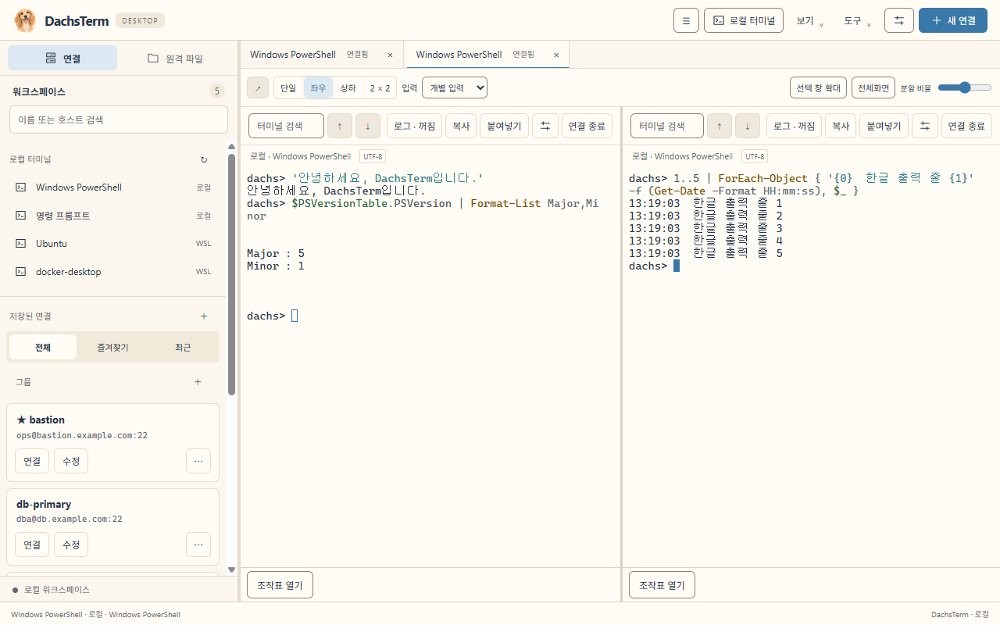

<p align="center">
  
</p>

<h1 align="center">DachsTerm</h1>

<p align="center">
  SSH 터미널, 파일 전송, 터널, 서버 모니터링을 한 창에 모은 로컬 데스크톱 클라이언트
</p>

<p align="center">
  <a href="https://github.com/splatoon-git/dachsterm-workspace/actions/workflows/windows.yml"></a>
</p>



<p align="center"><sub>기본 테마의 좌우 분할 화면. 서버 목록은 예시 데이터다.</sub></p>

DachsTerm은 Tauri 2와 Rust로 만든 SSH 클라이언트다. 별도 서버, 서버 에이전트, 계정이 필요 없다. 연결은 앱의 Rust 백엔드가 소유하므로 탭을 옮기거나 터미널을 새 창으로 분리해도 끊기지 않는다.

> [!IMPORTANT]
> **버전 0.5.1, Windows 베타 단계다.** 미리 빌드한 설치 파일이 없어 소스에서 빌드해야 하고, 설치 파일에 코드 서명이 없다. macOS용 빌드 구성은 있지만 실기기에서 실행한 결과가 아직 없다. 항목별 검증 상태는 [진행 기록](docs/progress.md)에 있다.

## 주요 기능

**터미널**

- SSH와 로컬 셸(PowerShell, 명령 프롬프트, WSL 자동 탐색)을 한 작업 공간의 탭으로 사용
- 좌우·상하·2×2 분할, 연결을 유지하는 독립 창 분리, 여러 터미널 동시 입력
- UTF-8, CP949/EUC-KR, Shift_JIS, GBK, Big5, Windows-1252 터미널 인코딩
- 스니펫, 기본 명령·로그 필터 모음, vi·less 등의 조작표, 마스킹과 회전을 지원하는 세션 로그

**연결과 인증**

- 비밀번호, 개인키(Ed25519·ECDSA·RSA), SSH agent, keyboard-interactive와 OTP·MFA
- 서버에서 이 PC의 키로 `git push`하는 SSH 키 전달. 서명할 때마다 창 안에서 승인
- 최대 4홉의 점프 호스트
- 최초 접속 시 호스트키 지문 확인, 키가 변경되면 접속 차단
- 비밀번호와 Passphrase는 OS 보안 저장소에 암호화 보관, 선택적 마스터 패스워드
- 그룹, 태그, 템플릿, 일괄 수정. PuTTY `.reg`, 세션 북마크 파일(`.mxtsessions`, `.ini`), OpenSSH `config`에서 세션 가져오기

**파일**

- SFTP·FTP·FTPS 파일 탐색기와 폴더 단위 업로드·다운로드
- 앱을 다시 시작해도 이어서 보낼 수 있는 영속 전송 큐
- VS Code, Cursor, Sublime 등 외부 편집기로 원격 파일 편집. 저장을 감지해 업로드하고 충돌을 확인
- SSH 서버에서 ZIP·TAR·TAR.GZ 압축과 해제

**서버에서 개발하기**

- 끊겨도 작업이 남는 tmux 세션 연결과 CLI 에이전트 작업 상태 표시·알림
- 서버 저장소의 Git 브랜치·변경 표시, 변경 검토 탭과 줄 의견을 프롬프트로 보내기
- 폴더를 골라 CLI 에이전트 시작(프리셋), 여러 탭의 에이전트 현황

**네트워크와 운영**

- Local, Remote, SOCKS5 터널(루프백 전용)
- 서버에 아무것도 설치하지 않는 Linux CPU·RAM·NET·DISK 모니터링
- [쿠버네티스 작업 화면](docs/user-guide.md#쿠버네티스-작업-화면): 트리·대시보드·로그·파드 셸·간단 제어. 기본은 쓰기를 막은 조회 모드

**그 밖에**

- 터미널과 차트까지 함께 바뀌는 테마 16종
- 쉴 때 쓰는 로컬 미니게임 7종. 서버에서 아무것도 실행하지 않는다

## 지원 범위

| 플랫폼 | 상태 |
|---|---|
| Windows 11 | 지원. 자동 검사와 실제 OpenSSH·FTP/FTPS 통합 검사를 수행한다 |
| macOS | 빌드 구성만 있음. 실기기 미검증 |

| 기능 | SSH/SFTP | FTP·명시적 FTPS |
|---|---|---|
| 세션 저장·OS 보안 저장소·마스터 패스워드 | 지원 | 지원 |
| 목록·파일 관리·권한 | 지원 | 지원(SITE CHMOD는 서버 지원 필요) |
| 업로드·다운로드·일시 중지·복구·재개 | 지원 | REST/SIZE/MDTM 지원 서버 |
| 원격 복사·폴더 복사·이동·삭제 | 지원 | 같은 연결 내 지원 |
| 외부 편집·저장 확인·자동 업로드 | 지원 | 미지원 |
| 압축·압축 해제 | Linux/Python3 서버 | 미지원 |
| 터미널·멀티 입력·분리 창·터널·모니터링 | 지원 | 미지원 |

**지원하지 않는 것**: X 서버, RDP/VNC, 매크로, 클라우드 동기화, 자동 업데이트, Pageant, FIDO2 키 직접 접근, GSSAPI/Kerberos, 호스트 CA 인증서, implicit FTPS, Active FTP, FXP, SOCKS5 UDP/BIND, 터널의 공개 인터페이스 바인딩.

## 설치

미리 빌드한 설치 파일은 아직 제공하지 않는다. Windows에서 소스로 빌드한다.

**필요 환경**: [Node.js](https://nodejs.org/) 24 이상, [rustup](https://rustup.rs/)(Rust 1.99.1은 `rust-toolchain.toml`이 지정한다), Visual Studio C++ Build Tools, Windows SDK, WebView2. 자세한 내용은 [Tauri 요구 사항](https://v2.tauri.app/start/prerequisites/)을 참고한다.

```powershell
git clone https://github.com/splatoon-git/dachsterm-workspace.git
cd dachsterm-workspace
npm ci
npm run tauri -- build --bundles nsis
```

설치 파일은 `target/release/bundle/nsis/DachsTerm_0.5.1_x64-setup.exe`에 생성된다. 서명이 없으므로 실행할 때 Windows SmartScreen 경고가 표시될 수 있다.

## 빠른 시작

1. 왼쪽 사이드바 **연결** 구역의 ⋯ → **새 연결**(`Ctrl+Shift+N`)에서 이름, 호스트, 포트, 사용자, 인증 방식을 입력하고 저장한다.
2. 사이드바 **연결** 목록에서 저장한 연결을 더블클릭한다. 서버를 처음 접속하면 서버 관리자가 제공한 SHA-256 지문과 대조한 뒤 신뢰한다.
3. 접속하면 왼쪽이 **파일**로 전환되고, 터미널의 현재 폴더를 따라가는 파일 트리가 열린다. 따라가기는 트리 위의 체크박스로 끌 수 있다.
4. 탭을 우클릭해 모든 탭을 좌우, 상하, 2 × 2로 나누고, 분할선을 끌어 크기를 맞춘다. **입력** 목록에서 동시 입력 범위를 고른다.

등록 없이 쓰려면 **로컬 터미널**(`Ctrl+Shift+L`)을 연다. 전체 단축키는 맨 위 키보드 아이콘(`Ctrl+Shift+/`)에서 볼 수 있다.

## 보안

- 저장 DB에는 인증정보의 참조만 두고, 실제 값은 OS 보안 저장소에 암호화해 보관한다. 평문 파일로 대체 저장하지 않는다.
- 변경되거나 폐기된 호스트키는 접속을 차단하며, 앱에 우회 버튼이 없다.
- OTP와 추가 인증 응답은 저장하지 않는다. 세션 내보내기에는 비밀번호, Passphrase, 개인키 내용이 들어가지 않는다.
- 마스터 패스워드를 잊으면 복구할 수 없다.

자세한 동작은 [사용 안내서](docs/user-guide.md#인증정보-보관)를 참고한다.

## 문서

| 문서 | 내용 |
|---|---|
| [사용 안내서](docs/user-guide.md) | 기능별 사용법, 상한, 제약, 게임 조작 |
| [세션 가져오기·내보내기](docs/session-transfer.md) | 지원 형식과 JSON 규약 |
| [개발 가이드](docs/development.md) | 개발 환경, 빌드, 검사, 실환경 테스트, 검증 기록 목록 |
| [구현 규칙](docs/engineering-rules.md) | 코드 작성과 검증 보고 규칙 |
| [로드맵](docs/roadmap.md) · [진행 기록](docs/progress.md) | 범위와 현재 상태의 정본 |

## 개발

```powershell
npm ci
npm run tauri -- dev           # 네이티브 앱 개발 실행
npm run dev                    # 브라우저 UI만 실행 (백엔드 없음)
./scripts/verify-windows.ps1   # CI와 같은 자동 검사 전체
```

React는 화면과 터미널 렌더링을 맡고, SSH 연결·전송·터널·모니터링·저장은 Rust(`src-tauri/`)가 소유한다. 자세한 내용은 [개발 가이드](docs/development.md)를 참고한다.

## 라이선스

프로젝트 라이선스는 아직 지정하지 않았다. 사용 중인 오픈소스의 고지는 [licenses/](licenses/)에 있다.
