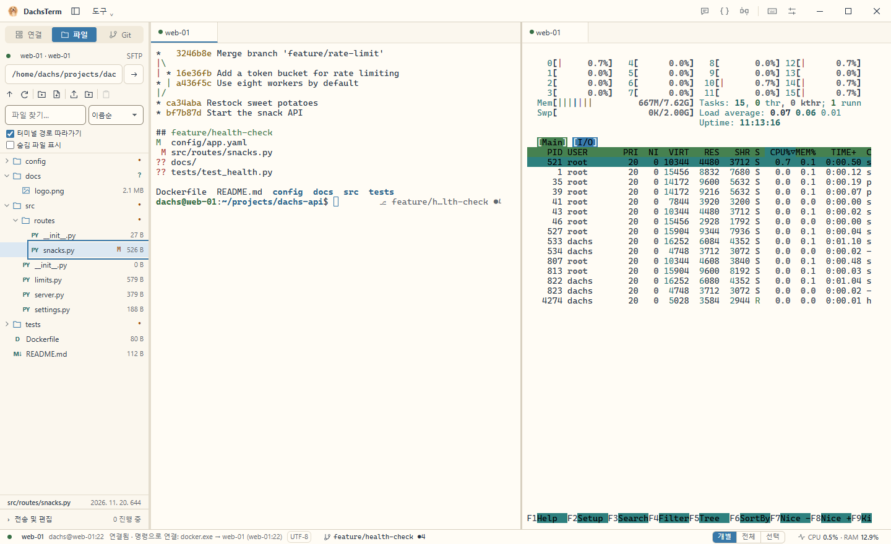
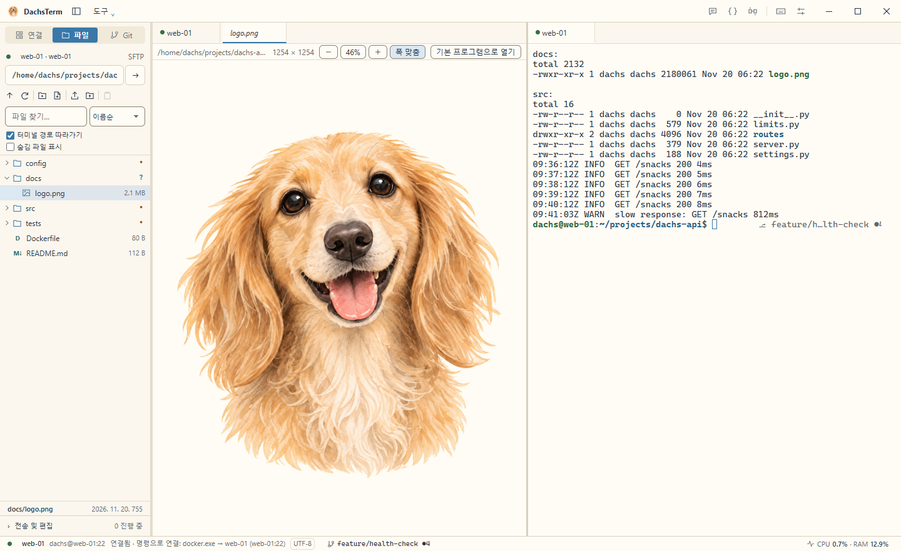
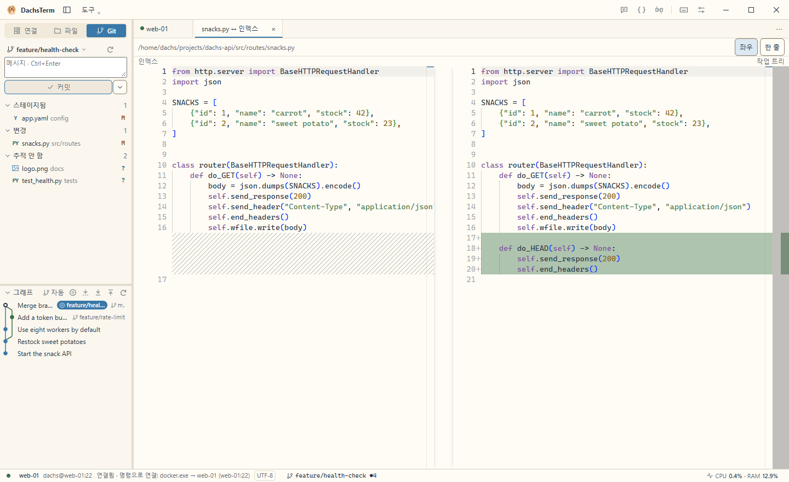
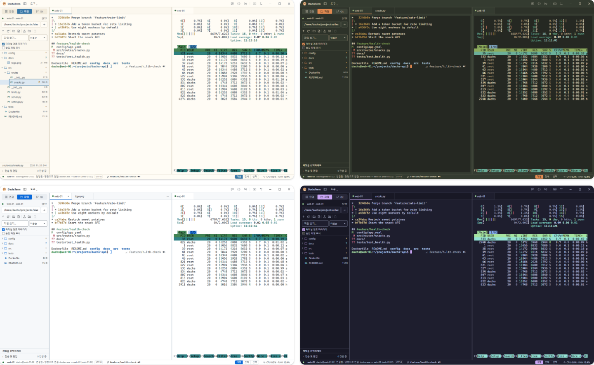

<p align="center">
  
</p>

<h1 align="center">DachsTerm</h1>

<p align="center">
  SSH 터미널, 파일 전송, 터널, 서버 모니터링을 한 창에 모은 Windows·macOS 데스크톱 클라이언트
</p>

<p align="center">
  <a href="https://github.com/splatoon-git/dachsterm-workspace/releases/latest"></a>
  <a href="https://github.com/splatoon-git/dachsterm-workspace/actions/workflows/windows.yml"></a>
  <a href="https://github.com/splatoon-git/dachsterm-workspace/actions/workflows/macos.yml"></a>
  <a href="LICENSE"></a>
</p>

<p align="center">
  <a href="#설치">설치</a> ·
  <a href="#빠른-시작">빠른 시작</a> ·
  <a href="#주요-기능">주요 기능</a> ·
  <a href="docs/user-guide.md">사용 안내서</a> ·
  <a href="#개발">개발</a>
</p>

<p align="center"><sub>A local SSH, SFTP and FTP desktop client for Windows 11 and macOS, built with Tauri and Rust. The UI is in Korean.</sub></p>



<p align="center"><sub>터미널을 좌우로 나누고, 왼쪽 파일 트리가 터미널의 현재 폴더를 따라간다. 서버와 프로젝트는 예시다.</sub></p>

## 소개

DachsTerm은 서버 작업에 필요한 도구를 한 앱에 모은 무료 SSH 클라이언트다.

- **설치하고 바로 쓴다.** 계정, 별도 서버, 서버에 까는 에이전트가 없다. 앱은 사용 통계를 보내지 않으며, 외부로 나가는 요청은 사용자가 연 연결과 업데이트 확인뿐이다.
- **연결이 끊기지 않는다.** SSH 연결은 Rust 백엔드가 소유한다. 탭을 옮기거나 터미널을 새 창으로 떼어 내도 셸은 그대로다.
- **터미널 옆에 필요한 것이 있다.** 현재 폴더를 따라가는 파일 트리, 전송 큐, 원격 파일 편집, Git, 터널, 모니터링, 쿠버네티스 화면이 같은 작업 공간에 붙는다.
- **비밀은 OS에 맡긴다.** 비밀번호와 Passphrase는 Windows 자격 증명 관리자와 macOS 키체인에 보관하고 앱의 DB에는 참조만 둔다.

> [!NOTE]
> **0.x 베타다.** 화면은 한국어만 제공한다. Windows 11에서 주로 쓰고 검증하며, macOS(Apple Silicon)는 일부 기능을 실기기에서 확인하는 중이다. 문제를 발견하면 [이슈](https://github.com/splatoon-git/dachsterm-workspace/issues)로 알려 주면 좋다.

## 설치

[최신 릴리스](https://github.com/splatoon-git/dachsterm-workspace/releases/latest)에서 OS에 맞는 파일을 받는다.

| OS | 파일 |
|---|---|
| Windows 11 x64 | `DachsTerm_<버전>_x64-setup.exe` |
| macOS 13.1 이상, Apple Silicon | `DachsTerm_<버전>_aarch64.dmg` |

설치 파일에는 아직 OS 코드 서명이 없어 처음 실행할 때 경고가 뜬다.

- **Windows**: `Windows의 PC 보호` 창에서 **추가 정보** → **실행**을 누른다. WebView2 런타임 111 이상이 필요하며, 업데이트되는 Windows 11에는 이미 들어 있다. 런타임이 오래됐으면 앱이 시작할 때 알려 준다.
- **macOS**: DMG를 열어 DachsTerm을 **응용 프로그램** 폴더로 옮긴 뒤 연다. 열 수 없다는 창이 뜨면 **시스템 설정 → 개인정보 보호 및 보안** 아래쪽의 **확인 없이 열기**를 누른다. 디스크 이미지나 다운로드 폴더에서 바로 실행하면 앱 안 업데이트를 쓸 수 없다.

새 버전이 나오면 제목 줄 오른쪽에 `새 버전 <버전>`이 나타난다. 앱은 내려받은 파일의 배포 서명을 확인한 뒤에만 설치한다. 자동 확인은 **설정 → 업데이트**에서 끌 수 있다([자세히](docs/user-guide.md#업데이트)).

## 빠른 시작

macOS에서는 단축키의 `Ctrl`을 `Cmd`로 바꿔 누른다.

1. 왼쪽 사이드바 **연결** 구역의 ⋯ → **새 연결**(`Ctrl+Shift+N`)에서 호스트와 인증 방식을 입력하고 저장한다. 다른 프로그램에서 쓰던 세션은 **설정 → 가져오기·내보내기**로 가져온다.
2. 저장한 연결을 더블클릭한다. 처음 접속하는 서버는 서버 관리자가 알려 준 SHA-256 지문과 대조한 뒤 신뢰한다.
3. 접속하면 사이드바가 **파일**로 바뀌고 터미널의 현재 폴더를 따라가는 파일 트리가 열린다.
4. 탭을 우클릭해 화면을 좌우, 상하, 2×2로 나눈다. **입력** 목록에서 여러 터미널에 동시에 입력할 범위를 고른다.

서버 없이 써 보려면 **로컬 터미널**(`Ctrl+Shift+L`)을 연다. 전체 단축키는 `Ctrl+Shift+/`로 본다.

## 주요 기능

**터미널**

- SSH, Telnet, 시리얼, 로컬 셸(PowerShell·명령 프롬프트·WSL, macOS의 Zsh·Bash)을 같은 작업 공간의 탭으로 사용
- 좌우·상하·2×2 분할, 연결을 유지하는 창 분리, 여러 터미널 동시 입력
- UTF-8, CP949/EUC-KR, Shift_JIS, GBK, Big5, Windows-1252 인코딩
- 스니펫, 명령·로그 필터 모음, vi·less 조작표, 하이라이트와 트리거, 마스킹·회전을 지원하는 세션 로그
- SFTP가 막힌 서버에서 터미널만으로 파일 주고받기(ZMODEM `sz`/`rz`, trzsz)

**연결과 인증**

- 비밀번호, 개인키(Ed25519·ECDSA·RSA), OpenSSH 사용자 인증서, SSH agent, Pageant(Windows), keyboard-interactive와 OTP·MFA
- 최대 4홉 점프 호스트, HTTP CONNECT·SOCKS5 프록시, `ProxyCommand`
- 서버에서 이 PC의 키로 `git push`하는 SSH 키 전달, HTTPS Git 자격 증명 전달(창 안에서 승인한 요청만 처리)
- X11 포워딩(이 PC에서 실행 중인 X 서버로 전달)
- 그룹, 태그, 템플릿, 일괄 수정. PuTTY `.reg`, 세션 북마크 파일(`.mxtsessions`, `.ini`), OpenSSH `config` 가져오기
- Ed25519 SSH 키 만들기

**파일**

- SFTP·FTP·FTPS 탐색기, 폴더 단위 업로드·다운로드, 탐색기·Finder와 끌어다 놓기
- 앱을 다시 시작해도 이어서 보내는 전송 큐
- 파일 탭에서 구문 강조 편집과 diff. 그림, PDF, Word, Excel, PowerPoint, 한글(hwp·hwpx) 미리보기
- **기본 프로그램으로 열기**와 외부 편집기로 원격 파일 편집. 저장하면 감지해 업로드하고 충돌을 확인
- 서버에서 ZIP·TAR·TAR.GZ 압축과 해제



**서버에서 개발하기**

- Git 보기: 스테이지·커밋·브랜치·stash·그래프, fetch·pull·push, 프롬프트 옆 브랜치 표시
- 변경 검토 탭과 줄 의견을 프롬프트로 보내기
- tmux 세션 연결, CLI 에이전트 시작 프리셋과 작업 상태 알림



**네트워크와 운영**

- Local, Remote, SOCKS5 터널(루프백 전용)과 서버의 개발 서버 포트를 브라우저로 여는 임시 터널
- 포트 개통, 포트 사용 여부, TLS 인증서를 포함한 서비스 연결, 경로 추적 점검(이 PC 또는 SSH 서버에서)
- 서버에 아무것도 설치하지 않는 Linux CPU·RAM·NET·DISK 모니터링
- [쿠버네티스 작업 화면](docs/user-guide.md#쿠버네티스-작업-화면): 트리, 대시보드, 로그, 파드 셸. 기본은 쓰기를 막은 조회 모드

**그 밖에**

- 터미널과 차트까지 함께 바뀌는 테마 16종
- 비밀정보 없는 설정 복구본과 진단 파일
- 쉴 때 하는 로컬 미니게임 7종(서버에서는 아무것도 실행하지 않는다)



<p align="center"><sub>왼쪽 위부터 DachsTerm Classic, Retro Dark, GitHub White, Catppuccin Mocha</sub></p>

<details>
<summary><b>프로토콜별 지원 범위</b></summary>

| 기능 | SSH/SFTP | FTP·명시적 FTPS | Telnet·시리얼 |
|---|---|---|---|
| 세션 저장 | 지원 | 지원 | 지원(암호 저장·자동 로그인 없음) |
| OS 보안 저장소·마스터 패스워드 | 지원 | 지원 | 해당 없음 |
| 목록·파일 관리·권한 | 지원 | 지원(SITE CHMOD는 서버 지원 필요) | 미지원 |
| 업로드·다운로드·일시 중지·재개 | 지원 | REST/SIZE/MDTM 지원 서버 | 미지원 |
| 원격 복사·이동·삭제 | 지원 | 같은 연결 안에서 지원 | 미지원 |
| 파일 탭 보기·편집·미리보기 | 지원 | 지원 | 미지원 |
| 기본 프로그램으로 열기·외부 편집 | 지원 | 미지원 | 미지원 |
| 압축·압축 해제 | Linux/Python3 서버 | 미지원 | 미지원 |
| 터미널·동시 입력·창 분리·터미널 안 전송 | 지원 | 미지원 | 지원 |
| 점프 호스트·프록시·터널·모니터링·X11 | 지원 | 미지원 | 미지원 |

**지원하지 않는 것**: 내장 X 서버, RDP/VNC, 매크로, 클라우드 동기화, FIDO2 키 직접 접근, GSSAPI/Kerberos, 호스트 CA 인증서, SOCKS4 프록시, implicit FTPS, Active FTP, FXP, SOCKS5 터널의 UDP/BIND, 터널의 공개 인터페이스 바인딩.

</details>

## 보안과 개인정보

- 비밀번호, Passphrase, 프록시 암호는 OS 보안 저장소에 암호화해 보관하고 평문 파일로 대체 저장하지 않는다. 마스터 패스워드를 따로 걸 수 있으며, 잊으면 복구할 수 없다.
- 처음 접속하는 서버는 호스트키 지문을 확인한다. 키가 바뀌거나 폐기되면 접속을 막고, 우회 버튼을 두지 않는다.
- OTP와 추가 인증 응답은 저장하지 않는다. 세션 내보내기 파일에는 비밀번호, Passphrase, 프록시 암호, 개인키가 들어가지 않는다.
- SSH 키 전달과 Git 자격 증명 전달은 요청마다 창 안에서 승인을 받는다.
- 업데이트는 배포 서명이 맞을 때만 설치하고, 확인 요청에는 세션·계정 정보가 들어가지 않는다.

자세한 동작은 [사용 안내서](docs/user-guide.md#인증정보-보관)에 있다. 보안 문제는 공개 이슈 대신 저장소의 [Security 탭](https://github.com/splatoon-git/dachsterm-workspace/security)에서 비공개로 신고해 주기 바란다.

## 문서

| 문서 | 내용 |
|---|---|
| [사용 안내서](docs/user-guide.md) | 기능별 사용법, 상한, 제약 |
| [세션 가져오기·내보내기](docs/session-transfer.md) | 지원 형식과 JSON 규약 |
| [개발 가이드](docs/development.md) | 개발 환경, 빌드, 검사, 릴리스 절차 |

## 개발

**필요 환경**: [Node.js](https://nodejs.org/) 24 이상, [rustup](https://rustup.rs/)(툴체인은 `rust-toolchain.toml`이 지정), [Tauri 요구 사항](https://v2.tauri.app/start/prerequisites/)의 OS별 도구.

```sh
git clone https://github.com/splatoon-git/dachsterm-workspace.git
cd dachsterm-workspace
npm ci
npm run tauri -- dev                        # 네이티브 앱 개발 실행
npm run dev                                 # 브라우저에서 UI만 실행 (백엔드 없음)

./scripts/verify-windows.ps1                # Windows: CI와 같은 자동 검사
bash scripts/verify-macos.sh                # macOS: CI와 같은 자동 검사

npm run tauri -- build --bundles nsis       # Windows 설치 파일
npm run tauri -- build --bundles app,dmg    # macOS 앱과 DMG
```

설치 파일은 `target/release/bundle/` 아래에 생긴다.

```text
src/          React UI와 xterm 렌더링 (features/ 아래 기능별 폴더)
src-tauri/    Rust 백엔드: SSH·SFTP·FTP, 전송 큐, 터널, 모니터링, 인증정보, SQLite
crates/       SSH 엔진 실증 도구(ssh-probe)
tests/        Playwright UI 테스트, 실제 앱 검사, 실환경 테스트용 서버 구성
scripts/      검사·빌드 스크립트와 Docker 기반 실환경 테스트 실행기
```

React는 화면과 터미널 렌더링만 맡고 연결, 전송, 저장은 Rust가 소유한다. 버그 보고와 제안은 [이슈](https://github.com/splatoon-git/dachsterm-workspace/issues)로 받는다. 코드를 고치기 전에 [개발 가이드](docs/development.md)와 [구현 규칙](docs/engineering-rules.md)을 먼저 읽어 주기 바란다.

## 라이선스

[Apache License 2.0](LICENSE)으로 배포한다. 저작권 표시는 [NOTICE](NOTICE)에, 사용 중인 오픈소스의 고지는 [licenses/](licenses/)에 있으며 설치 파일에도 `THIRD_PARTY_NOTICES.txt`로 들어 있다. 이 라이선스는 DachsTerm 이름과 Dachs 마스코트의 상표 사용권을 주지 않는다.
