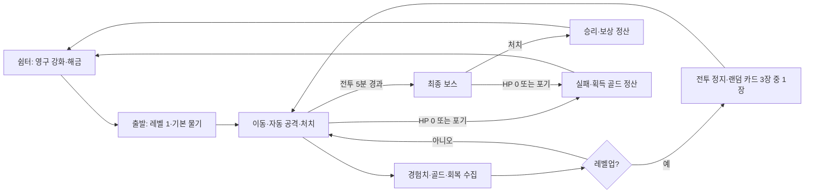

# 닥스의 서바이버 — 게임 설계안

- 작업 ID: **G.8**, 설계일: **2026-11-05**.
- 현재 요청 범위: G.8.1 전투/HP/XP 엔진 이후 **G.8.2 카드·6무기·8능력·3진화·다시 뽑기** 구현. 적 확장·저장·화면·실환경 검증(G.8.3~G.8.6)은 후속 작업이며 상태 정본은 progress다.
- 사용자 확정: 서바이버류 로그라이크, HP·경험치·골드, 레벨업 시 랜덤 능력 카드, **5분 생존 후 최종 보스**, **골드로 영구 강화·해금**.
- 아래 무기 수, 수치, 등장 확률, 비용은 구현의 출발점인 제안값이다. 재미·난이도·성능이 검증된 값으로 취급하지 않는다.
- 범위·완료 기준의 상위 정본은 [roadmap.md §11 / G.8](../roadmap.md), 현재 상태와 다음 행동은 [progress.md](../progress.md)다. 이 문서는 해당 작업의 상세 설계다.

## 1. 플레이 경험과 첫 버전 범위

장모 크림 닥스훈트가 숲의 몬스터에게 둘러싸인 상황에서 이동으로 위험을 피하고 자동 공격으로 성장한다. 조작은 간단하게 유지하고, 매번 달라지는 카드 조합으로 플레이 방식이 바뀌게 한다.

한 판은 **전투 시간 5분 + 보스전**이다. 카드 선택·일시정지는 시간에 포함하지 않는다. 보스전은 약 30~90초를 목표로 조정하되 강제 종료 시간은 두지 않는다.

| 이번 판의 성장 | 다음 판까지 남는 성장 |
|---|---|
| 레벨, 경험치, 무기, 능력 카드, 무기 진화, 현재 HP | 골드 잔액, 영구 강화, 해금, 설정, 최고 기록 |
| 매 판 레벨 1·기본 무기부터 시작 | 출발 능력과 선택 가능한 콘텐츠 확장 |
| 사망·포기·클리어 시 초기화 | 사망해도 획득 골드는 유지 |

첫 버전 콘텐츠는 캐릭터 1종, 숲 맵 1종, 무기 6종, 지속 능력 8종, 진화 3종, 일반 적 5종, 정예 2종, 최종 보스 1종으로 잡는다. 맵의 장식·적 배치·드롭·카드는 시드에 따라 달라진다. 무기 중 2종은 골드로 해금한다.

온라인 순위·멀티플레이·과금·제작·인벤토리·분기 맵·진행 중 상점·장비 등급·런 전체의 앱 재시작 복원은 첫 버전에서 다루지 않는다. 카드 희귀도에 따른 별도 수치 추첨도 두지 않는다. 우선 카드 조합 자체의 재미를 검증한다.

## 2. 한 판의 흐름

1. 쉼터에서 영구 강화와 해금, 조작 설명, 기록을 확인하고 시작한다.
2. WASD/방향키로 8방향 이동한다. 대각선 이동 속도는 정규화한다. 공격은 자동이다.
3. 적을 처치하면 경험치 결정이 남는다. 골드·회복 간식은 별도 드롭이다. 접근하면 자동 수집한다.
4. 레벨업하면 적·투사체·타이머·효과음을 정지하고 카드 3장 중 1장을 고른다.
5. 2분·4분에 정예가 등장한다. 5분을 버티면 보스전에 들어간다.
6. HP가 0이 되거나 보스를 처치하면 결과를 표시하고 골드를 정산한다. 다음 판은 새 카드 조합으로 시작한다.

## 3. 기본 능력치와 HP

게임 좌표의 1단위를 기준으로 계산하며 창 크기로 전투 능력이나 충돌 범위가 달라지지 않는다.

G.8.1의 초기 월드는 3,200×3,200, 고정 논리 전장은 960×540, 플레이어/슬라임 충돌 반경은 각각 20/18이다. 카메라는 플레이어를 중심으로 월드 안에 제한한다. G.8.5 렌더러는 논리 전장을 같은 비율로 축소·확대해 창 크기 때문에 사거리나 스폰 안전거리가 바뀌지 않게 한다. 이 크기와 첫 레벨업 난이도는 실플레이로 확정한 밸런스 값이 아니다.

| 능력치 | 초기 제안 | 성장·제한 |
|---|---:|---|
| 최대 HP | 100 | 영구 강화와 튼튼한 심장으로 증가 |
| 시작 HP | 최대 HP | 새 판마다 회복 |
| 이동 속도 | 초당 210 | 빠른 발 카드, 합산 증가 상한 50% |
| 공격력 보너스 | 0% | 무기 기본 피해에 영구·카드 증가량을 합산 |
| 공격 주기 감소 | 0% | 합산 상한 50%, 모든 무기 주기에 적용 |
| 방어력 | 0 | 피해에서 차감, 최소 피해 1 |
| 수집 반경 | 64 | 영구 강화·후각 증가율 합산 |
| 피격 후 무적 | 0.75초 | 접촉 밀집으로 한 프레임에 즉사하지 않게 함 |
| 자연 회복 | 없음 | 드롭 간식·카드로 회복 |

- 피해 계산: `max(1, round(적 기본 피해 × 구간 배율) - 방어력)`.
- 무기 피해: `round(무기 랭크별 기본 피해 × (1 + 영구 공격력 보너스 + 카드 공격력 보너스))`.
- 공격 주기: `기본 주기 × max(0.5, 1 - 주기 감소율)`.
- 최대 HP: `round(100 × (1 + 영구 HP 증가율)) + 심장 카드의 추가 HP`.
- 최대 HP 카드 획득 시 늘어난 최대 HP만큼 현재 HP도 늘린다. 그 외 능력 카드 획득 자체가 자동 회복을 주지는 않는다.
- 일반 회복 간식은 최대 HP의 20%를 회복한다. 최대치를 넘는 회복은 버린다.
- 적 접촉·투사체·위험 지대는 같은 피격 무적을 공유한다. 피격은 짧은 반동과 시각·소리로 알리되 조작을 길게 잠그지 않는다.
- G.8.1 접촉 피해는 같은 틱의 접촉 적 중 기본 피해가 가장 큰 1개를 적용하고 동률이면 작은 ID를 우선한다. 무적은 45틱이다. 반동은 초기 속도 120에 틱당 0.75 감쇠를 적용하며 이동 입력은 계속 반영한다. 물기 범위 판정은 적의 원형 충돌체와 부채꼴의 교차를 사용한다. 공격/피격의 화면·음향은 G.8.5에서 연결한다.
- HP 0은 부활 없이 해당 판 종료다. 영구 부활 구매는 첫 버전에 없다.

## 4. 경험치와 레벨

레벨과 무기 랭크는 별개다. 레벨은 카드를 얻는 횟수, 무기 랭크는 선택한 무기의 강화 단계다.

- 레벨 1, 경험치 0에서 시작한다. 현재 레벨을 `L`이라 할 때 다음 레벨 비용은 `6 + 3 × (L - 1) + floor((L - 1)² / 4)`다.
- 경험치는 다음 레벨 비용을 차감하고 남은 양을 이월한다. 한 번에 여러 레벨을 올리면 카드 선택을 순서대로 처리한다.
- 일반 적의 기본 경험치는 3, 빠른 적 4, 원거리 적 5, 튼튼한 적 8, 정예 40이다. 후반 등장 적은 §8의 경험치 배율을 적용한다.
- 똑똑한 닥스의 경험치 배율은 획득 시 적용한다. 내부에는 소수 잔여를 보존하고 HUD에만 내림 표시한다.
- 첫 선택은 약 10초 안팎, 이후에는 약 10~20초 간격, 5분 시점 레벨 16~22를 초기 조정 목표로 삼는다. 실제 플레이로 곡선·스폰·드롭을 함께 조정한다.
- 첫 버전의 레벨 상한은 40이다. 상한에서는 XP 획득을 멈추고 바에 `MAX`를 표시한다. XP를 자동으로 골드로 바꾸지는 않는다.
- 경험치 결정은 임의 시간으로 사라지지 않는다. 개수가 많아지면 주변 결정을 합쳐 총 경험치 양을 보존한다.

## 5. 레벨업 카드

### 선택 구조

카드는 새 무기, 기존 무기 강화, 새 지속 능력, 기존 지속 능력 강화, 조건을 만족한 무기 진화로 구성한다. 매번 **서로 다른 카드 3장 중 1장**을 고른다.

- 무기 슬롯은 **4개**, 지속 능력 슬롯도 **4개**다. 기본 물기가 무기 슬롯 1개를 사용한다.
- 무기·지속 능력의 일반 최대 랭크는 **5**다. 새 항목은 랭크 1, 재선택은 한 랭크 증가다.
- 슬롯이 가득 차면 미보유 항목을 후보에서 제외한다. 최대 랭크·미해금 항목도 제외한다. 기존 보유 항목은 계속 강화할 수 있다.
- 동일한 카드가 한 화면에 중복되지 않는다. 카드를 열 때 후보와 난수를 고정하므로 탭 전환·정지·리사이즈로 다시 추첨되지 않는다.
- 선택된 카드에는 실제 변화량을 표시한다. 예: `튼튼한 심장 2 → 3 / 최대 HP 130 → 145 / 현재 HP +15`.
- 다시 뽑기는 기본 **판당 1회**, 영구 해금 시 최대 2회다. 현재 선택 화면을 다시 만들며 횟수를 차감한다. 앞 화면과 일부 카드가 다시 나올 수 있음을 표시한다.

### 추첨 규칙

1. 슬롯·랭크·해금·진화 조건으로 유효 후보 목록을 만든다.
2. 유효 후보가 있으면 카드 한 자리는 보유 항목 강화 또는 조건을 만족한 진화에서 뽑는다. 초반에 기본 물기 강화를 확보할 기회를 준다.
3. 새 무기를 넣을 공간이 있고 보유 무기가 2개 미만이면 남은 자리 중 한 자리는 새 무기에서 뽑는다.
4. 나머지는 남은 후보에서 중복 없이 동일 가중치로 뽑고 표시 위치를 섞는다. 이 보장 규칙은 첫 화면과 다시 뽑기에 동일하게 적용한다.
5. 유효 후보가 3개 미만이면 실제 후보를 전부 제시하고 빈 자리에 일회성 보상 `최대 HP 25% 회복`, `골드 +8`을 각 한 번 넣는다. 그래도 부족하면 1~2장만 표시한다. 체력 최대 상태에서는 회복 대신 골드 카드만 남길 수 있다.
6. 일반 후보가 완전히 소진되어도 골드 카드로 선택을 마칠 수 있게 한다. 카드 없음 때문에 판이 멈추는 상태는 허용하지 않는다.

### 지속 능력 8종

| 카드 | 랭크당 효과 | 랭크 5 효과 | 선택 의미 |
|---|---|---|---|
| 날카로운 이빨 | 공격력 +10%p | +50% | 모든 무기 피해 강화 |
| 빠른 꼬리 | 공격 주기 -8%p | -40% | 자동 공격 빈도 증가 |
| 튼튼한 심장 | 최대·현재 HP +15 | 최대 HP +75 | 실수 허용과 즉시 회복 |
| 복슬복슬 털 | 방어력 +1 | +5 | 잦은 접촉 피해 완화 |
| 빠른 발 | 이동 속도 +5%p | +25% | 돌진·포위 회피 |
| 예민한 코 | 수집 반경 +25%p | +125% | 위험 지역의 드롭 수집 |
| 똑똑한 닥스 | 경험치 +10%p | +50% | 초반 투자·후반 카드 수 증가 |
| 행운의 발바닥 | 획득 골드 +15%p | +75% | 전투력을 양보하고 영구 성장 투자 |

여기서 `%p`는 같은 보너스 내의 덧셈이다. 같은 카드를 거듭 골라도 복리로 곱하지 않는다. UI에서는 사용자에게 최종 수치와 이번 증가량을 보여준다.

## 6. 무기와 진화

### 무기 6종

다음 표는 랭크 1의 시작값이다. 공통 피해 배율은 랭크 1~5에 `1 / 1.3 / 1.65 / 2.05 / 2.5`를 사용하고, 추가 변화는 표에 따로 정의한다. 자동 표적은 범위 내 가장 가까운 적이며 같은 거리에서는 적 ID 순서로 고른다.

| 무기 | 공격 방식·랭크 1 | 랭크 3 / 5 추가 변화 | 시작 해금 |
|---|---|---|---|
| 와앙 물기 | 0.85초마다 가까운 적 방향 120도 부채꼴, 반경 90, 피해 18 | 반경 105 / 125 | 기본 장착 |
| 뼈다귀 부메랑 | 1.4초마다 표적 방향 왕복, 최대 거리 420, 편도 속도 420, 피해 16 | 동시 발사 2개 / 3개 | 기본 |
| 멍멍 파동 | 2.6초마다 원형 파동, 최대 반경 150, 피해 22·넉백 | 반경 180 / 220 | 기본 |
| 수호 공 | 반경 95 궤도를 초당 1회전, 공 1개, 접촉 피해 10 | 공 2개 / 3개 | 기본 |
| 발자국 장판 | 1.2초마다 현재 위치에 3초 지속 영역, 반경 65, 0.5초마다 피해 6 | 지속 4초 / 반경 85 | 골드 100 |
| 도토리 소나기 | 2초마다 가까운 적 위치 0.5초 예고 후 낙하, 반경 70, 피해 26 | 서로 다른 표적 2개 / 3개 | 골드 150 |

- 물기는 표적이 범위 밖이면 공격을 보류한다. 부메랑·도토리는 표적 탐색 반경 520이며 적이 없으면 대기한다. 멍멍 파동·수호 공·발자국은 표적 없이 동작한다.
- 한 물기·파동·도토리 폭발은 같은 적에게 한 번만 명중한다. 부메랑은 같은 적에게 나갈 때와 돌아올 때 각각 한 번 명중할 수 있다.
- 수호 공은 같은 적에 대한 피격 간격 0.5초를 공 전체가 공유한다. 발자국 영역이 겹쳐도 같은 소유자의 장판 피해는 적당 0.5초에 한 번이다.
- 공격 주기 감소는 발사·생성 주기와 수호 공의 회전 속도에 적용한다. 장판의 피해 틱 간격·지속 시간·수호 공의 재피격 간격에는 적용하지 않는다.
- 적의 사망은 한 번만 처리한다. 여러 투사체가 동시에 맞아도 드롭과 처치 수가 중복되지 않는다.

### 진화 3종

무기 랭크 5 + 대응 지속 능력 랭크 3 이상 + 전투 시간 3분 이상이면 해당 진화 카드가 후보에 추가된다. 조건 달성 즉시 자동 진화하지 않는다. 한 판 최대 2개까지 진화하며 무기 슬롯과 기존 강화는 유지한다.

| 조합 | 진화 | 변화 제안 |
|---|---|---|
| 와앙 물기 + 날카로운 이빨 | 왕와앙 | 랭크 5 피해의 1.6배, 부채꼴 180도·반경 150 |
| 뼈다귀 부메랑 + 빠른 꼬리 | 황금 뼈다귀 | 랭크 5 피해의 1.4배, 최대 거리 520, 돌아온 뒤 0.5초 후 두 번째 왕복 |
| 멍멍 파동 + 복슬복슬 털 | 사자후 | 랭크 5 피해의 1.5배, 같은 발동에서 0.4초 뒤 두 번째 파동 |

진화한 무기는 일반 강화·같은 진화 후보에서 제외한다. 두 번째 왕복·파동도 별도 공격 ID로 명중을 추적한다. 사자후 넉백은 보스에게 적용하지 않는다. 진화 세부 수치는 전투 실증 후 조정한다.

### G.8.2에서 확정한 전투 계산 규칙

- 피해는 `round(기본 피해 × 랭크 배율 × 진화 배율 × (1 + 합산 공격 보너스))`로 마지막에 한 번 반올림한다. 발사 주기는 60Hz 틱으로 올림하고 수호 공 회전은 연속 각도로 계산한다.
- 부메랑 충돌 반경은 12, 다중 발사의 방향 간격은 12도다. 발사 지점에서 최대 거리까지 직선으로 갔다가 같은 지점으로 돌아온다. 이동 구간 전체를 판정하여 작은 적을 한 틱에 통과해도 명중한다. 황금 뼈다귀의 추가 왕복은 귀환 30틱 후 현재 플레이어 위치에서 같은 방향으로 한 번 발사한다.
- 파동은 18틱(0.3초) 동안 최대 반경까지 퍼지고 같은 적에게 한 번 명중한다. 넉백 초기 속도 180에 틱당 0.75 감쇠를 사용한다. 사자후는 첫 발동 위치에서 시작 24틱(0.4초) 후 한 번 더 퍼진다. 후속 보스는 `knockbackImmune`를 설정한다.
- 수호 공의 충돌 반경은 14, 궤도 반경은 95이며 공 전체의 재피격 제한은 30틱이다. 랭크 상승으로 공을 재배치하는 순간에는 이전/새 위치 사이에 경로 피해를 주지 않는다. 장판도 적별 공통30틱 제한을 적용하며 겹친 영역 중 큰 피해 한 번을 적용한다. 생성 주기가 빨라져도 장판 수명과 피해 간격은 유지한다.
- 도토리는 거리/ID 순으로 서로 다른 표적의 발사 시점 위치를 고정하고 30틱 후 폭발한다. 예고 뒤 이동한 적을 다시 추적하지 않으며 각 폭발은 단발이다. 폭발 표시 데이터는 6틱 유지한다.
- 이미 발사한 공격과 남은 발사 대기는 발동 당시 수치를 유지한다. 이후 발사는 새 강화 수치로 계산하고 수호 공의 접촉 피해/회전은 현재 능력치를 적용한다. 공격 배열은 공·예고·지연된 추가 공격까지 포함해 240개로 제한하며 상한에 걸린 새 발사는 예약하지 않는다.
- 위 값은 재현 가능한 엔진 규칙이며 재미·5분 밸런스·WebView2 성능을 검증한 값이 아니다. 후속 실플레이 조정 시 `content.ts`와 이 절을 함께 갱신한다.

## 7. 골드·영구 강화·해금

### 획득과 사용

골드는 HP·XP와 다른 자원이다. **판 안에서는 모으고, 판 밖 쉼터에서 소비한다.** 카드 선택에는 골드를 쓰지 않는다.

- 일반 적 처치 시 10% 확률로 기본 골드 1을 드롭한다. 정예는 골드 15와 회복 간식 1개를 확정 드롭한다.
- 일반 회복 간식은 별도 2% 확률로 드롭한다. 골드 추첨과 독립적이며 동시에 나올 수 있다.
- 최종 보스 처치 보상은 골드 40, 첫 클리어 추가 보상은 30이다. 해당 보상은 바닥에 떨어뜨리지 않고 결과 정산에 직접 추가한다.
- 일반 드롭·정예 드롭·골드 카드에는 `1 + 행운 카드 보너스 + 영구 골드 보너스`를 획득 시 적용한다. 보스 클리어·첫 클리어 보상에는 적용하지 않는다.
- 보너스 계산의 소수 잔여는 판 안에서 누적하고 정산 시 한 번 내린다. 카드 획득 전 골드에 새 배율을 소급 적용하지 않는다.
- 사망·포기해도 이미 수집한 골드를 전부 보존한다. 바닥에 남은 골드·XP는 사라진다. 클리어 때도 미수집 드롭을 자동 회수하지 않는다.
- 초기 목표 수익은 실패 판 20~50, 첫 클리어 100~150이다. 실제 처치량과 수집 행동에 따라 달라지므로 플레이로 검증한다.

### 영구 강화 제안

| 항목 | 단계별 효과 | 최대 단계 | 각 단계 구매 비용 |
|---|---|---:|---|
| 든든한 몸 | 기본 최대 HP +5%p | 5 | 30, 50, 80, 120, 180 |
| 튼튼한 이빨 | 공격력 +3%p | 5 | 40, 65, 100, 150, 220 |
| 간식 탐지 | 수집 반경 +10%p | 3 | 30, 60, 100 |
| 저금 습관 | 획득 골드 +5%p | 3 | 50, 90, 150 |
| 한 번 더 고민 | 카드 다시 뽑기 +1회/판 | 1 | 150 |

영구 강화는 첫 판부터 클리어 가능한 난이도를 전제로 보조한다. 공격력·HP 상한을 낮게 두어 반복 구매 자체가 필수가 되지 않게 한다. 새 무기 해금은 선택지를 늘리며 장착은 판 안의 카드로 결정한다. 첫 버전은 캐릭터 해금 없이 기존 크림 닥스 한 캐릭터에 집중한다.

구매는 쉼터에서만 가능하다. 비용·효과·구매 후 잔액을 표시하고 저장 성공 후 적용한다. 잔액 부족·최대 단계·중복 입력에는 차감하지 않는다. 영구 강화 전액 환불 기능을 제공해 골드를 다른 강화에 배분할 수 있게 하되 무기·다시 뽑기 해금은 환불 대상에서 제외하고 명시한다. 환불액은 현재 가격표가 아니라 해당 단계에 실제 지불한 금액의 합계이며 강화 단계 초기화와 함께 저장한다.

## 8. 적·5분 난이도·최종 보스

### 일반 적

| 적 | 역할 | 초기 HP / 속도 / 접촉 피해 | 기본 XP |
|---|---|---|---:|
| 풀 슬라임 | 느린 추적·초반 연습 | 24 / 70 / 10 | 3 |
| 밤 박쥐 | 빠른 추적·퇴로 압박 | 18 / 135 / 10 | 4 |
| 가시 버섯 | 중거리 정지·단발 투사체 | 32 / 55 / 12 | 5 |
| 돌멩이 골렘 | 느리고 튼튼한 벽 | 100 / 45 / 18 | 8 |
| 꼬마 멧돼지 | 0.7초 예고 후 짧은 직선 돌진 | 45 / 75 / 15 | 4 |

투사체·돌진·도약은 공격 전에 형태와 움직임으로 예고한다. 색상만으로 위험을 전달하지 않는다. 가시 버섯의 투사체 피해는 기본 10, 주기는 3초다. 일반 멧돼지 돌진은 속도 300·0.6초, 회복 1초·재사용 대기 3초로 시작한다.

| 전투 시간 | 등장 구성 | 초당 기본 생성 수 | HP / 피해 / XP 배율 | 특별 이벤트 |
|---|---|---:|---|---|
| 0:00~0:59 | 슬라임 100% | 0.8 | 1 / 1 / 1 | 기본 조작·첫 카드 |
| 1:00~1:59 | 슬라임 65%, 박쥐 35% | 1.4 | 1.15 / 1 / 1 | 빠른 적 도입 |
| 2:00~2:59 | 슬라임 35%, 박쥐 35%, 버섯 30% | 2.0 | 1.35 / 1.1 / 1.25 | 2:00 정예 거대 슬라임 |
| 3:00~3:59 | 슬라임 20%, 박쥐 25%, 버섯 25%, 골렘 30% | 2.6 | 1.6 / 1.2 / 1.5 | 무기 진화 후보 개방 |
| 4:00~4:59 | 슬라임 15%, 박쥐 25%, 버섯 20%, 골렘 20%, 멧돼지 20% | 3.2 | 1.9 / 1.3 / 1.75 | 4:00 정예 갑옷 멧돼지 |
| 5:00 이후 | 최종 보스 | 일반 생성 중지 | 보스 고유 값 | 숲의 폭군 등장 |

- 구간 배율은 생성 시 확정한다. 이미 살아 있는 적이 분 경계를 넘는 순간 갑자기 강해지지 않는다. 적 속도는 구간 배율로 올리지 않는다.
- 정예는 일반 생성 예산과 별개로 1회 등장한다. 거대 슬라임은 HP 600·접촉 피해 20, 갑옷 멧돼지는 HP 1,000·피해 25의 고유 값이며 일반 구간 배율을 다시 곱하지 않는다. XP는 각각 40, 일반 생성 상한에 닿아도 정예 자리 2개를 별도로 확보한다.
- 거대 슬라임은 추적 속도 55, 4초마다 0.8초 예고 후 반경 100의 도약 공격을 한다. 갑옷 멧돼지는 추적 속도 70, 4초마다 0.8초 예고→속도 330으로 0.8초 돌진→1.2초 회복한다.
- 스폰은 보이는 전장 밖·플레이어와 안전거리 240 이상인 위치를 고른다. 유효 위치를 찾지 못하면 해당 생성을 건너뛰며 플레이어 위에 생성하지 않는다.
- 5분 진입 시 기존 일반·정예 적과 적 투사체를 퇴장시키며 처치 XP·골드를 새로 주지 않는다. 기존 바닥 드롭과 플레이어의 무기는 유지한다. 1.5초 경고 후 최종 보스를 한 번 생성한다.

### 최종 보스: 숲의 폭군

- 초기 HP 5,000, 기본 추적 속도 75. 보스전 진행 시간은 5분 생존 시간과 별도로 표시한다.
- 패턴은 `예고 0.9초 → 돌진 0.9초 → 회복 1.2초 → 부채꼴 씨앗탄 예고 0.8초 → 발사 → 회복 1.2초 → 착지 위치 예고 1초 → 도약 착지 → 회복 1.5초` 순서다.
- 돌진 속도 320·피해 25, 씨앗탄 5개·속도 160·피해 15, 착지 반경 110·피해 30. 씨앗탄은 3초 또는 월드 밖에서 소멸한다.
- HP 50% 이하에서는 회복 시간을 20% 줄이고 씨앗탄을 7개로 늘린다. 경고 시간은 유지한다.
- 보스전 90초 후에는 추적·돌진 속도를 15% 올려 긴 회피 반복에 압박을 준다. 추가 중첩·즉사 타이머는 없다.
- 보스 HP가 0이면 승리한다. 같은 시뮬레이션 틱에 플레이어 HP도 0이면 패배를 우선하고 클리어 보너스를 주지 않는다.
- 카드를 고르는 동안 보스와 패턴 시간도 멈춘다. 보스전에 들어가도 바닥 XP로 레벨업할 수 있다.

## 9. 화면·조작·표현

### 화면 구조

- 쉼터: `시작 / 영구 강화 / 무기 해금 / 기록`, 현재 골드와 다음 구매 효과. 게임 탭 안에서 전환한다.
- 전투 상단: HP `현재/최대`, `남은 생존 시간`, 레벨·XP 바, 이번 판 골드, 처치 수. 영구 잔액과 이번 판 골드를 혼동하지 않게 이름을 구분한다.
- 전장: 닥스 중심의 이동 카메라, 읽기 쉬운 적·드롭·공격 예고. 아래에 무기 4칸·지속 능력 4칸과 랭크를 표시한다.
- 카드 선택: 전투 위의 탭 내부 선택 패널, 카드 이름·종류·랭크·변화량·진화 조건, 다시 뽑기 잔여 횟수.
- 결과: 성공/사망/포기, 생존·보스 시간, 레벨, 처치 수, 최종 조합, 이번 판 수집 골드·보너스·총 잔액, `다시 시작 / 쉼터`.
- 최초 플레이에 이동·자동 공격·XP·카드 선택을 짧게 설명한다. 도움말은 정지 화면에서 다시 볼 수 있다.

### 입력

| 입력 | 전투 중 | 그 외 |
|---|---|---|
| WASD / 방향키 | 8방향 이동 | 카드에서는 방향키로 선택 이동 |
| Space / Enter | 별도 수동 공격 없음 | 준비 화면 시작, 정지 화면 재개, 포커스된 카드 확정 |
| 1 / 2 / 3 | 없음 | 표시된 카드 즉시 선택 |
| R | 없음 | 카드 다시 뽑기, 잔여 횟수가 있을 때만 |
| P | 정지 | 일반 정지에서 재개, 카드 선택 건너뛰기 불가 |
| M | 효과음 전환 | 설정 유지 |
| Esc | 기존 작업 화면으로 복귀·판 유지 | 선택 패널에서도 복귀, 선택지는 유지 |

- 게임판·카드 패널이 입력을 소유할 때만 키를 처리한다. 숨겨진 터미널에 전달하지 않는다. 텍스트 입력과 Ctrl/Meta/Alt 조합을 전역에서 가로채지 않는다.
- 시작·카드 확정·다시 뽑기·재개는 키 반복을 무시한다. 카드 선택 직후 키를 계속 누르고 있어도 다음 카드가 자동 선택되지 않게 keyup 경계를 요구한다.
- 카드가 뜨거나 탭/창 포커스를 잃으면 눌린 이동키·포인터를 비운다. 돌아와도 자동으로 전투를 재개하지 않는다.
- 화면 조작은 8방향 가상 패드와 정지 버튼을 제공한다. 포인터 취소·창 밖 해제도 입력을 지운다. UI 목표 크기는 최소 44px다.
- 360px에서는 카드 3장을 세로로 배치하고 패널 내부 스크롤을 허용한다. 560/1280px에서는 공간에 맞게 3열을 사용한다.

### 시각·소리

- 기존 장모 크림 닥스와 `dachshund-adventure-atlas.png`를 우선 재사용한다. 현재 원본은 횡방향 포즈이므로 탑다운 전장에서 좌우 반전·그림자로 표현하며 실제 8방향 스프라이트가 있다고 가정하지 않는다.
- 초기 월드는 §3 및 현재 엔진과 같은 3,200 × 3,200의 열린 숲 공터다. 경계는 보이게 표현하고 플레이어 이동을 제한한다. 첫 버전의 나무·풀·돌은 장식이며 보이지 않는 충돌물을 만들지 않는다.
- 논리 시야는 §3과 같은 960 × 540으로 고정하고 화면에 맞게 비례 축소한다. 창이 좁아져도 적이 갑자기 가까이 생성되거나 시야 자체가 좁아지지 않게 한다.
- 캐릭터 원본 색상은 유지한다. UI·월드·카드·효과 색상은 기존 공통 테마에서 파생한다. 추가 의미 색상이 필요하면 전체 테마 계약을 확장한다.
- 타격음, XP 수집음, 레벨업, 진화, 보스 경고는 Web Audio 합성 효과로 시작한다. 사용자 입력 후 활성화하고 음소거를 저장한다. 다수 명중음의 동시 재생 수·빈도를 제한한다.
- 화면 흔들림은 보스 공격·피격에 짧게만 사용한다. 모션 줄이기에서는 흔들림·장식 입자를 끄고 공격 예고·HP 정보는 유지한다. 전체 화면 섬광은 사용하지 않는다.
- HUD는 DOM 텍스트로 읽을 수 있게 하고 카드 패널에 포커스를 이동한다. 캔버스 안의 전체 실시간 전투가 스크린리더로 완전 조작 가능하다고 주장하지 않는다.

## 10. 상태·저장·기존 앱과의 연결

### 상태 전이

`hub → playing → choosing → playing`, `playing/choosing → paused`, `playing → result → hub`를 기본 흐름으로 사용한다.

- `paused`에는 복귀할 이전 상태를 보존한다. 카드 선택 중 창을 벗어나면 재개 후 같은 카드를 보여주며 전투로 건너뛰지 않는다.
- 한 틱의 우선순위는 입력·이동·공격·피해 확정 → 사망/승리 판정 → 살아 있을 때 드롭 수집·XP 처리 → 카드 선택 → 시간 구간/보스 전환이다. 사망은 미처리 카드·회복보다 우선한다.
- 여러 레벨업은 `pendingChoices`로 쌓는다. 한 장 선택 후 상태를 반영해 다음 후보를 만든다. 모두 고를 때까지 전투 시간은 멈춘다.
- 5분과 레벨업이 겹치면 선택을 마친 후 보스 경고로 넘어간다. 난수·시간·카드 선택을 렌더링 프레임에서 직접 변경하지 않는다.
- 탭 전환·Esc는 판을 유지한다. 탭 닫기·명시적 포기·다시 시작은 현재 판을 포기 정산하고 종료한다. 단순 재렌더링이나 비활성화는 종료로 취급하지 않는다.

### G.8.1~G.8.2 엔진 연결 계약

- `survivor/engine.ts`의 `newSurvivor(seed, options?)`는 기본 옵션에서 레벨 1·HP 100·물기만 가진 `playing` 런을 만든다. 옵션으로 해금 무기·추가 다시 뽑기·시작 보너스를 전달할 수 있다. 시작 보너스와 카드 보너스를 합산해 재계산하며 HP/공격/수집/골드 시작 보너스는 §7의 최대치로 제한한다. 구매·저장 검증은 G.8.4, 쉼터/준비 UI는 G.8.5이며 기존 게임 목록에는 아직 등록하지 않는다.
- `stepSurvivor(run, dtSeconds, { moveX, moveY })`는 소유한 런을 제자리 갱신하고 처리한 틱 수를 반환한다. 이동 축은 -1~1, 대각선은 정규화하며 입력이 없으면 정지한다. 호출자는 런을 ref로 유지하고 DOM/IPC/저장을 엔진 안으로 넣지 않는다.
- `tick / 60`이 처리한 전투 시간이다. 남은 부분 틱만 누적하고 한 호출 최대 5틱 이후 지연은 버린다. `pauseSurvivor`/`resumeSurvivor`는 이전 `playing`/`choosing` 상태를 보존하고 부분 틱을 비운다. UI는 비활성 동안 RAF를 중단하고 재개 시 벽시계 기준점도 다시 잡아야 한다.
- XP는 살아 있을 때 수집하며 비용 차감 후 잔여량을 보존한다. 여러 레벨업은 `pendingChoices`에 쌓고 `choosing`에서 전투를 멈추며 `run.choice`에 첫 선택을 고정한다. `progression.ts`의 `chooseSurvivorCard(run, choiceId, cardId)`는 현재 화면에 있는 유효 카드만 적용하고 대기 횟수를 1 감소시킨다. 남은 선택은 변경된 슬롯/랭크로 재생성하고 모두 끝나면 `playing`으로 돌아온다. 오래된 화면 ID·중복·정지 중 입력은 false를 반환하며 상태를 바꾸지 않는다. UI의 키 반복/keyup 경계 처리는 G.8.5에서도 별도로 필요하다.
- `rerollSurvivorCards(run, choiceId)`는 현재 선택과 잔여 횟수를 확인해 다시 뽑고 새로운 화면 ID를 발급한다. 후보는 `eligibleCards(run)`으로 난수 소비 없이 조회할 수 있다. 카드에는 이름·종류·이전/이후 랭크·실제 수치 변화 배열을 제공한다. 정지/재개나 조회가 다시 추첨하지 않으며 추첨/선택 후 다음 후보 생성만 cards 스트림을 소비한다.
- 현재 전투는 §6의 무기6종/진화3종과 `slime`, `xp` 드롭을 제공한다. 초기 슬라임은 75틱마다 화면 밖 안전 위치를 최대 16번 탐색해 생성한다. 5분 구간 전환과 골드/회복 물리 드롭은 G.8.3이다. 스폰·드롭·카드 난수는 분리되어 있으며 카드 다시 뽑기가 스폰을 바꾸지 않는다.
- `run.gold`는 이번 판의 소수 잔여를 포함한 수집 골드다. 후보 부족 골드 카드와 후속 골드 드롭은 `collectSurvivorGold(run, baseAmount)`로 현재 보너스를 적용한다. 기존 골드에는 소급하지 않으며 클리어 고정 보상은 이 함수를 사용하지 않는다. 잔액·정산·저장 구현은 G.8.4다.
- 전투 콘텐츠 버전은 2다. `weapons.ts`가 공격 생성/명중/수명과 종류별 객체 재사용을 맡고, 공간 격자는 현재 가장 큰 적 반경까지 검색한다. 공격은 `run.attacks`의 ID/종류/위치/반경/예고 시점, 물기는 `run.bite.lastAttack`으로 렌더링할 수 있다. 공격 ID는 런 안에서 고유하고 반복 진화 공격도 새 ID를 받는다. 런 자체를 영구 프로필 형식으로 저장하지 않는다.
- 적 공간 격자·일반 적 180/XP 드롭 250 상한을 사용한다. 사망한 적/수집한 드롭 객체를 재사용하므로 렌더러는 엔티티 참조를 틱 사이에 보관하지 않고 ID로 추적한다. XP 상한에서는 가장 가까운 결정(동률이면 작은 ID)에 값을 합친다. 이 기반 구현이 실제 WebView2 성능 목표 통과를 뜻하지 않는다.

### 영구 저장

기존 최고 기록용 `useBest`는 단일 숫자만 저장하므로 영구 골드·구매·중복 정산에는 사용하지 않는다. 새 버전 키 `daxterm.games.survivor.v1`에 아래 데이터를 하나의 레코드로 저장한다.

| 구분 | 데이터 |
|---|---|
| 프로필 | schemaVersion, 골드 잔액, 강화 단계·단계별 실제 지불 골드, 해금 ID, 첫 클리어 보상 여부 |
| 설정·기록 | 음소거, 모션 설정, 최고 생존 시간·레벨·처치 수, 승리 수 |
| 진행 판 체크포인트 | runId, seed, 확정 수집 골드, 마지막 저장 시각 |
| 정산 | 최근 정산 runId와 결과 요약, 최대 20개 |

- 골드·단계는 유한 수·허용 범위·해금 ID를 검사한다. 골드는 정수 0~9,999,999이며 상한 초과분은 버린다. 알 수 없는 미래 스키마·손상 데이터는 덮어쓰지 않고 저장 불가를 알린다.
- 판 시작 시 체크포인트를 만들고, 5초마다 수집 골드를 저장한다. 카드 선택·일시정지·정상 종료 시에도 저장한다. 비정상 종료 시 최근 5초 이내의 미저장 골드는 복구되지 않을 수 있다.
- 다음 실행에서 전투 판은 복원하지 않는다. 이전 체크포인트가 남아 있으면 중단 판으로 정산해 마지막 저장 골드를 돌려준다. 처치·승리·첫 클리어 보너스를 새로 만들지 않는다.
- 정산은 `잔액 증가 + 기록 변경 + 정산 runId 기록 + 체크포인트 제거`를 같은 저장 레코드의 한 번 쓰기로 처리한다. 같은 runId의 종료 이벤트를 다시 처리해도 중복 지급하지 않는다.
- 정산 대상은 현재 체크포인트와 runId가 일치하는 판으로 제한한다. 일치하는 진행 판이 없으면 지급하지 않으므로 최근 20개 기록에서 빠진 오래된 종료 이벤트도 다시 지급되지 않는다.
- 앱의 여러 창에서 동시에 골드를 쓰지 못하게 프로필 단위 단일 소유권을 확보한다. 구현안은 Web Locks로 게임 탭 생존 기간의 소유권을 유지하고 다른 창에는 읽기 전용 쉼터를 표시하는 방식이다. 저장 이벤트로 잔액을 갱신한다. 대상 WebView에서 지원 여부를 실제 확인한다.
- 잠금 API 미지원·저장 접근 불가이면 영구 프로필을 수정하지 않는 임시 플레이로 안내한다. 저장 실패 시 구매 성공으로 표시하거나 기존 저장을 초기화하지 않는다. 정산 실패 시 현재 결과를 유지하고 저장 재시도를 제공한다.
- 영구 저장의 핵심 검증은 골드 수식보다 중복 정산·구매 연타·체크포인트 복구·여러 창 소유권·저장 실패에 둔다.

### 코드 구조 제안

| 파일/영역 | 책임 |
|---|---|
| `src/features/games/catalog.ts` | `survivor`와 표시명 등록 |
| `src/features/games/GamePane.tsx` | 기존 게임 탭에 연결, 포커스·Esc 계약 유지 |
| `src/features/games/survivor/types.ts` | 런·프로필·무기·적·입력 상태 계약 |
| `src/features/games/survivor/content.ts` | 카드·무기·진화·적·구간·상점 데이터 |
| `src/features/games/survivor/engine.ts` | 고정 시간 전투, 충돌·피해·드롭·XP·종료 |
| `src/features/games/survivor/weapons.ts` | 6무기·진화 공격·명중 간격·투사체/영역 수명·객체 재사용 |
| `src/features/games/survivor/progression.ts` | 유효 카드 추첨·강화·진화·영구 수치 계산 |
| `src/features/games/survivor/profile.ts` | 저장 검증·구매·소유권·체크포인트·정산 |
| `src/features/games/survivor/renderer.ts` | Canvas 2D 월드·스프라이트·시각 효과 |
| `src/features/games/survivor/SurvivorGame.tsx` | 쉼터·HUD·카드·결과, 입력과 엔진 연결 |
| `src/features/games/survivor/survivor.css`, `audio.ts` | 테마 연동 UI, 제한된 합성 효과음 |

`src/app/App.tsx`의 게임 탭 수명·닫기 경로를 확인해 포기 정산을 명시적으로 연결한다. React effect 정리만으로 정산하지 않는다. 렌더러나 게임 프레임에서 SSH/PTY/파일 IPC를 호출하지 않는다. 기존 6종 게임 엔진과 `useRound`를 일괄 개조하지 않고 서바이버의 카드·정산 상태를 별도로 다룬다.

## 11. 렌더링·성능 설계

- 전투 월드는 Canvas 2D, 메뉴·HUD·카드는 React DOM으로 나눈다. 적마다 React 컴포넌트를 생성하거나 매 프레임 전체 객체를 React 상태로 복사하지 않는다.
- 시뮬레이션은 60Hz 고정 간격, 렌더링은 requestAnimationFrame을 사용한다. 한 프레임 최대 5틱까지만 따라잡고 긴 지연은 버린다. 실제 전투 시간은 처리한 틱으로만 증가한다.
- HUD 갱신은 최대 10Hz로 제한하되 레벨업·피격·정산 등 의미 있는 변화는 즉시 반영한다. 비활성 상태에서는 루프와 오디오를 멈춘다.
- 충돌 후보는 공간 격자로 좁힌다. 적·투사체·효과·드롭 배열에는 각각 상한을 두고 제거된 객체는 재사용한다.
- 초기 상한: 일반 적 180, 정예 2, 보스 1, 플레이어 투사체/공격 영역 240, 적 투사체 100, 드롭 250, 장식 효과 160. 상한은 프로파일링 후 조정한다.
- 적 상한이면 추가 일반 생성을 건너뛴다. 플레이어/적 투사체 상한이면 새 발사를 생략하고 지난 공격을 무한 예약하지 않는다. 드롭 상한에서는 같은 종류의 가까운 드롭을 합쳐 가치 총량을 보존한다. 효과는 오래된 장식부터 버린다.
- 시드 난수는 전투 스폰·드롭·카드별 스트림으로 분리한다. 카드 다시 뽑기나 장식 렌더링이 다음 적 스폰을 바꾸지 않는다. 같은 콘텐츠 버전·초기 프로필·시드·입력·선택 순서에서 재현 가능하게 한다.
- 성능 목표는 Windows WebView2의 1280px 전장에서 상한 부하 60초 동안 프레임 처리 시간 p95 16.7ms 이내, 정지/복귀 후 밀린 스폰 없음, 반복 10판 후 메모리의 지속 상승 없음이다. 측정 환경·방법·수치는 검증 문서에 남긴다. 현재 통과한 성능 결과가 아니다.

## 12. 구현 순서와 완료 기준

설계 작업 **G.8.0**과 제품 구현 **G.8.1~G.8.6**을 구분한다. 현재 요청은 **G.8.2**이며 이후 소번호는 별도 요청 범위다.

| ID | 구현 범위 | 완료 증거 |
|---|---|---|
| G.8.0 | 게임 규칙·화면·성장·저장·구현 순서 설계 | 확정 요구 반영, 문서 간 링크·수치·상태 전이 검토 |
| G.8.1 | 데이터 계약·고정 시간 엔진·이동·물기·슬라임·HP·XP | 정상/대각 이동, 충돌·무적·사망, 시간 분할에 따른 재현 검사 |
| G.8.2 | 카드 선택·6무기·8능력·3진화·다시 뽑기 | 슬롯/최대 랭크/해금/후보 부족/연속 레벨업/진화·중복 명중 검사 |
| G.8.3 | 5분 생성 흐름·정예·최종 보스·드롭·승패 | 분 경계·생성 안전거리·보스 전환·동시 사망·보상 1회, 실제 입력 완주 |
| G.8.4 | 골드·쉼터·영구 강화/환불·해금·저장/복구 | 구매/정산 원자성·실패·중복 입력·여러 창·중단 체크포인트 회수 |
| G.8.5 | 게임 탭·Canvas·HUD·카드·조작·음향·테마 | 360/560/1280px, 카드 포커스·키 반복·Esc·정지·모션 줄이기·기존 6종 회귀 |
| G.8.6 | 밸런스·성능·Windows 실제 실행·배포 산출물 | 5분+보스 전체 흐름, 부하 측정, WebView2·실제 PTY/SSH 입력 격리·release 식별 |

### 필수 검증 시나리오

- 무강화 프로필·서로 다른 시드로 전체 판을 직접 플레이해 초반 생존 가능성과 카드 선택 빈도를 기록한다. 자동 시뮬레이션만으로 재미나 첫 판 클리어 가능성을 판정하지 않는다.
- 순수 엔진: 30/60/120Hz 입력 프레임으로 같은 고정 틱 결과, 접촉 무적·다중 명중, HP/XP 경계, 슬롯·후보 고갈, 5분 경계·정예 1회·보스 사망, 결정 병합의 가치 보존.
- 저장: 골드 보너스 소수 처리, 구매/환불, 잔액 부족, 결과 중복 실행, 쓰기 예외, 앱 강제 종료 후 체크포인트 회수, 서로 다른 창의 동시 실행·소유 창 종료 후 복구.
- 브라우저: 키보드만으로 시작→선택→일시정지→재개→결과, 연속 레벨업 시 선택 연타 방지, 카드 중 탭/창 이탈, 다시 뽑기 제한, 클릭/포인터 취소, 좁은 UI·라이트/다크·모션 줄이기.
- 통합: 기존 6종 게임과 터미널 탭 유지, 카드 숫자키·WASD·P/R/M/Space/Enter가 실제 로컬 PTY에 입력되지 않음. 실제 SSH 연결에서도 따로 확인하고 로컬 결과로 대체하지 않는다.
- Windows: 최종 내장 자산의 실제 WebView2 전투·정지·카드·영구 저장·앱 재실행. 빌드 성공과 실제 실행 성공을 구분한다.
- Mac 실기기·물리 멀티터치·실제 SSH·최신 NSIS 설치본 검사는 실행 환경과 범위에 맞게 별도로 기록한다. 대기 항목이 있으면 G.8 전체 검증 완료로 보고하지 않는다.

### 최초 구현 때 확인할 기술 항목

1. 현재 닥스 atlas를 Canvas에 그렸을 때 360px에서도 방향과 피격을 구분할 수 있는지 확인한다.
2. Windows WebView2와 Mac WKWebView의 Web Locks·영구 저장 동작을 각각 확인한다. 미지원 시 임시 플레이 경로가 사용자에게 명확한지 검증한다.
3. `App.tsx`의 탭 닫기·앱 종료 경로와 프로필 정산을 연결하되 기존 터미널 종료 동작은 바꾸지 않는다.
4. 수치 조정은 콘텐츠 테이블과 이 문서에 함께 반영하고 실제 측정값은 별도 검증 기록으로 남긴다.
